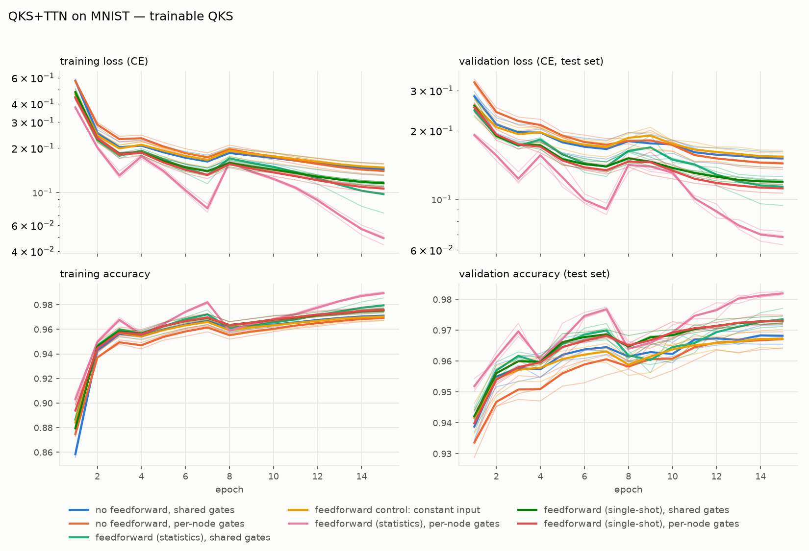
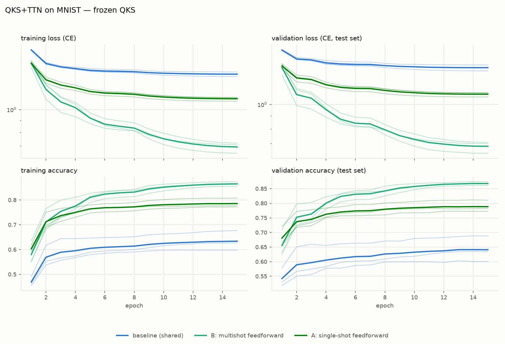

# Feedforward measurement in QKS+TTN

Does using the discarded register's measurement outcome — instead of tracing it out — improve
image classification with the QKS+TTN ansatz of [arXiv:2208.13895](https://arxiv.org/abs/2208.13895)?

Design note: *Feedforward measurement in QKS+TTN: single-shot vs multishot* (Notion). Two variants:

| | Case A — single-shot | Case B — multishot statistics |
|---|---|---|
| fed-forward object | outcome bits `b` of the discarded register | outcome probabilities `p = diag(Tr_keep σ)` |
| parent unitary | stack `U(b_L, b_R)` (χ² = 16 unitaries per layer) | `expm(i(H0 + Σ_k p_L[k] H_k^L + Σ_k p_R[k] H_k^R))` |
| linear in the input state | yes → exact tensor network | no → one forced bottom-up sweep |
| expressivity vs. baseline | none (block-diagonal widening of the parent) | genuinely nonlinear |

## Code

Everything lives in `qks-tn-library/`; the original notebooks and `common_functions/qks_tn.py` are untouched.

- `common_functions/qks_tn_ff.py` — `FeedforwardTNLayer(mode='baseline'|'A'|'B', share_per_layer, shots,
  ff_layers, ff_features, ff_null)`: the dissipative TTN as an explicit batched bottom-up sweep (no
  `vectorized_map`, no `tensornetwork`), plus `FastFeatureEncodingLayer` (batched QKS with identical
  weights/initialisation). `mode='baseline'` reproduces `qks_tn.TNLayer` to 1e-7 (forward) and 1e-4
  (relative gradient) and is ~4.6× faster on CPU.
- `tests/test_ff_equivalence.py` — 13 tests: old-vs-new equivalence, zero-coupling reductions of A and B
  to the baseline, unitarity, normalisation, shot sampling, finite differences. Run with
  `.venv/bin/python qks-tn-library/tests/test_ff_equivalence.py`.
- `run_ff_experiment.py` — notebook-faithful pipeline (deskewed MNIST, AdamW + cosine restarts, batch 32,
  15 epochs) with named configs (`--config C0 … F5`), per-epoch train/validation logging to JSON.
- `modal_ff_sweep.py` — one Modal GPU job per (config, seed); per-epoch history on the `qks-tn-results`
  Volume; `python3 -m modal run qks-tn-library/modal_ff_sweep.py --configs C0,C2 --seeds 0,1,2`.
- `analyze_ff_runs.py` — tables (mean ± s.e.m., paired per-seed differences, McNemar tests) and curves.

Two facts about the original code that the implementation had to respect: the vertex map is
`σ = Uᵀ ρ conj(U)` (from how `tf.reshape` orders the legs), and all vertices of a layer share one unitary
(only 6 of `TNLayer`'s 63 parameter columns are live — 1,530 of 16,065 parameters).

## Experiment (sweep `ff-v1`, 10-class MNIST, 3 seeds per config, T4 GPUs)

Same seed ⇒ same QKS initialisation, same base unitaries, same data order across configs.
Validation = the 10k test set evaluated every epoch (training set is the paper's full 60k).

| config | model | TN params | trainable | test acc | test CE |
|---|---|---|---|---|---|
| C0 | baseline, shared unitaries (the paper's model) | 1,530 | 102,010 | 0.9682 ± 0.0017 | 0.151 ± 0.007 |
| C1 | baseline, per-vertex unitaries | 16,065 | 116,545 | 0.9671 ± 0.0015 | 0.144 ± 0.004 |
| C3 | B with constant *p* (information-free control) | 11,730 | 112,210 | 0.9672 ± 0.0018 | 0.154 ± 0.008 |
| C5 | **A: single-shot feedforward** | 21,930 | 122,410 | **0.9729 ± 0.0009** | 0.119 ± 0.002 |
| C2 | **B: multishot feedforward** | 11,730 | 112,210 | **0.9736 ± 0.0018** | 0.114 ± 0.010 |
| C4 | **B, per-vertex** | 79,305 | 179,785 | **0.9820 ± 0.0003** | 0.068 ± 0.003 |
| F0 | baseline, QKS frozen (TN-only learning) | 1,530 | 1,530 | 0.641 ± 0.026 | 1.40 ± 0.02 |
| F5 | A, QKS frozen | 21,930 | 21,930 | 0.789 ± 0.011 | 1.10 ± 0.01 |
| F2 | B, QKS frozen | 11,730 | 11,730 | **0.868 ± 0.004** | 0.68 ± 0.02 |

Paired per-seed differences (candidate − control; McNemar exact test on test-set errors):

| comparison | isolates | Δ acc (pp) | Δ CE | sign by seed | McNemar p |
|---|---|---|---|---|---|
| C1 − C0 | 10× more TN parameters, no feedforward | −0.11 ± 0.05 | −0.007 | − − − | n.s. all seeds |
| C3 − C0 | B's extra parameters with *p* held constant | −0.10 ± 0.16 | +0.003 | + − − | n.s. (one seed worse) |
| C2 − C3 | the fed-forward *information* itself | +0.63 ± 0.36 | −0.040 | + + + | 4e-4, 4e-20, 0.44 |
| C2 − C0 | multishot feedforward vs the paper's model | +0.53 ± 0.29 | −0.037 | + + − | 6e-6, 3e-10, 0.94 |
| C5 − C0 | single-shot feedforward vs the paper's model | +0.47 ± 0.24 | −0.032 | + + + | 5e-11, 2e-3, 0.65 |
| C5 − C1 | A vs parameter-matched baseline | +0.58 ± 0.23 | −0.024 | + + + | 1e-11, 3e-3, 0.09 |
| C4 − C1 | per-vertex B vs per-vertex baseline | **+1.48 ± 0.12** | **−0.075** | + + + | 1e-27, 5e-24, 5e-20 |
| F2 − F0 | B, TN-only learning | **+22.7 ± 2.4** | −0.72 | + + + | ≈ 0 |
| F5 − F0 | A, TN-only learning | **+14.8 ± 2.7** | −0.30 | + + + | ≈ 0 |




## Reading

1. **Feedforward helps, and the gain comes from the information, not the parameters.** More unitaries
   alone (C1) or the same B parametrisation fed a constant (C3) do nothing; B fed the real statistics
   (C2) beats its information-free twin on every seed. Adding unitaries *without* information is even
   slightly negative.
2. **Per-vertex B is the clear winner with trainable features: 98.2 % vs 96.8 %** (−55 % test cross-entropy),
   consistent on all three seeds (σ = 0.03 pp). With shared unitaries the two feedforward variants are
   similar (+0.5 pp; A is the more seed-stable, B the lower-loss), and one seed of B is a wash.
3. **When only the tensor network learns, feedforward changes the picture qualitatively**: 64 % → 87 % (B)
   and 79 % (A). This is the setting where the design note's expressivity argument is tested most
   directly, and B — the only variant that is nonlinear in the input state — is well ahead of A.
4. Cost is modest: on a T4, baseline 13 ms/step, A 18, B 27 (per-vertex B 29); a 15-epoch multiclass run
   is 8–16 minutes.

Decision rule stated before the sweep (paired difference vs the parameter-matched control positive on
every seed and > 2 s.e.m.): met by C4 vs C1, C5 vs C1, F2 vs F0, F5 vs F0; C2 vs C3 is positive on all
seeds but its s.e.m. (0.36 pp) is inflated by the seed-2 tie, so it needs more seeds to clear the bar.

## Checkpointing and training for more epochs

Every run writes a `tf.train.Checkpoint` (model weights, AdamW moments and the optimizer step counter that
drives the cosine-restart schedules) after each epoch, next to the metric history:

- locally: `qks-tn-library/runs/ckpt/<run name>/` (disable with `--no-checkpoint`);
- on Modal: `/out/<sweep>/<job>/ckpt/` on the `qks-tn-results` Volume.

`ckpt-<epoch>` is the rolling latest (one kept); in addition the state at the end of every annealing
cycle — epochs 1, 3, 7, 15, 31, 63 — is kept permanently in `cycle-<epoch>/` (checkpoint + history), so
any cycle boundary can be restored with `--resume-from <ckpt_dir>/cycle-015/ckpt` (the local runner) or
compared post hoc.

To continue a run, re-issue it with a larger `--epochs`; the Modal launcher resumes automatically
(`--fresh` retrains from scratch), the local runner needs `--resume`:

```bash
python3 -m modal run qks-tn-library/modal_ff_sweep.py --configs C0,C2,C4 --seeds 0,1,2 --epochs 31 --sweep <sweep>
.venv/bin/python qks-tn-library/run_ff_experiment.py --config C2 --task binary --epochs 31 --resume
```

The schedule is `CosineDecayRestarts(first_decay_steps = 1 epoch)` with period doubling, so the warm
restarts fall at epochs 1, 3, 7, 15, 31, …; stop at a cycle boundary (15, 31, 63 epochs) — stopping
mid-cycle leaves the learning rate high. Resumed training reproduces the schedule and the epoch-boundary
state exactly; only the data-shuffle order differs from an uninterrupted run. The `ff-v1` sweep predates
checkpointing, so extending it would retrain those jobs from scratch (31 epochs ≈ 15–30 min per job).

Longer/deeper follow-up (launched 2026-08-25): sweeps `ff-v2-L6` (128 episodes, 6 layers) and `ff-v2-L7`
(`--nepisodes 256`, 7 layers, QKS 200,960 params) with the minimal config set C0, C1, C2, C4 × 3 seeds at
**63 epochs** (the fifth cycle boundary), with cycle checkpoints, to test whether the ff-v1 ordering holds
with longer training and a deeper tree.

## Longer training and deeper trees (sweeps `ff-v2-L6`, `ff-v2-L7`; 63 epochs, 3 seeds)

| depth | C0 baseline | C1 per-vertex baseline | C2 shared B | C4 per-vertex B |
|---|---|---|---|---|
| 6 layers (128 episodes), 15 ep (`ff-v1`) | 0.9682 ± 0.0017 | 0.9671 ± 0.0015 | 0.9736 ± 0.0018 | 0.9820 ± 0.0003 |
| 6 layers, 63 ep | 0.969–0.974 | 0.969–0.974 | 0.980–0.983 | **0.9856–0.9864** |
| 7 layers (256 episodes), 63 ep | 0.9782 ± 0.0013 | 0.9784 ± 0.0004 | 0.9841 ± 0.0005 | **0.9871 ± 0.0004** |

Four times longer training adds ~0.3 pp to the baselines and ~0.4–0.9 pp to the feedforward models;
a deeper tree lifts everything by ~1 pp; the ordering is unchanged and every paired comparison
(C2 − C0, C4 − C1) is positive on all seeds with McNemar p ≤ 3·10⁻⁵ (depth 7). Per-vertex unitaries
without feedforward remain worthless (C1 − C0 = +0.01 ± 0.10 pp at depth 7).

Two pipeline bugs were found and fixed on 2026-08-25 while extending to new datasets — both leave the
MNIST results above untouched (60000/32 is exact; MNIST is not class-sorted):
1. *Windowed index shuffle* (250k-row buffer) on the class-sorted HF ImageNet-32 train split ⇒ training
   at chance. Now a full permutation of indices every epoch.
2. *Cosine-schedule drift*: `steps_per_epoch = n // 32` but the ragged last batch was not dropped, so
   CIFAR-10 (1563 vs 1562 steps) and ImageNet-32 drifted one step per epoch and finished 15 steps into a
   restarted cycle at peak learning rate (CIFAR-10 val acc fell 0.32 → 0.29 between epochs 14 and 15).
   Training batches now use `drop_remainder=True`. CIFAR-10 numbers from sweep `cifar10-L5` are
   therefore superseded by `lenet-v1-cifar`.

## Other datasets: CIFAR-10 and ImageNet-32 (5-layer trees)

`--task cifar10` (tf.keras) and `--task imagenet32` (HF `benjamin-paine/imagenet-1k-32x32`: ImageNet-1k
centre-cropped + Lanczos-resampled to 32×32; 1,281,167 train / 50,000 val) are supported with
`--nepisodes 64` (32 leaves, 5 layers). Inputs are the 3072 raw pixel values in [0, 1] (no deskewing);
the kitchen-sink weight scale is `σ = 0.125·√(784/3072) ≈ 0.063` so the encoding angles have the same
variance as on MNIST. CIFAR-10 keeps the paper's fixed 16→10 readout; ImageNet-32 (1000 classes) uses a
trainable linear 16→1000 logits head (17k parameters, identical across configs). The training set is
held in a CPU `tf.Variable` (uint8, 3.9 GB for ImageNet-32) and batches are gathered by shuffled index,
which avoids TensorFlow's 2 GB graph-constant limit. `prepare_data` downloads/decodes each dataset
once into the `qks-tn-data` Volume (ImageNet-32: 164 s).

GPU choice (per-vertex B, 5 layers, 3072-dim inputs, batch 32; one ImageNet-32 job = 600k steps):

| GPU | ms/step | wall/job | $/h | $/job |
|---|---|---|---|---|
| T4 | 22 | 3.7 h | 0.59 | 2.16 |
| L4 | 24 | 4.0 h | 0.80 | 3.20 |
| A10G | 20 | 3.3 h | 1.10 | 3.67 |
| L40S | 17 | 2.8 h | 1.95 | 5.53 |
| A100-40GB | 33 | 5.5 h | 2.10 | 11.6 |

The step is launch-latency-bound (thousands of 16×16 complex kernels), so larger GPUs barely help;
T4 is cheapest overall. Sweeps `cifar10-L5` and `imagenet32-L5` (C0, C1, C2, C4 × seed 0, 15 epochs)
were launched 2026-08-25 on T4s.

## LeNet-style architecture (`qks_tn_lenet.py`, sweeps `lenet-v1-mnist`, `lenet-v1-cifar`)

LeNet's ingredients — local receptive fields, weight sharing across positions, pooling, feature maps,
FC layers — mapped onto the primitives here:

| LeNet | QKS+TTN primitive |
|---|---|
| conv filter on a patch, shared across positions | `PatchQKSEncodingLayer`: two kitchen-sink filters applied to every `patch×patch` window (a `conv2d`); the two angles form one χ=4 leaf register per position. MNIST 7×7/stride 3 → 8×8 positions, **100 encoder parameters** (vs 100,480 dense); CIFAR 4×4×3/stride 4 → 8×8, 98 parameters |
| feature maps | `groups=G` registers per position (leaves position-major, group-minor: the first log₂G merges are 1×1 channel mixing) |
| conv + 2×2 pool | a TTN vertex (unitary + dissipative trace) on leaves ordered along a **Z/Morton curve**, so successive merges alternate x and y and every two layers contract a 2×2 block (quadtree) |
| nonlinearity between stages | feedforward mode B |
| FC → classes | trainable linear head (`--head linear`) or the paper's fixed readout |

Controls: `R*` = same weights with raster leaf order (isolates 2-D locality in the tree; fully paired
with `L*` — identical initialisation, permutation only); `U*` = locally connected filters (one filter bank
per position, 6,400 params on MNIST; isolates weight sharing); dense `C*` (isolates locality).
σ for the encoder follows the dimensional rule σ = 0.125·√(784/(patch²·C)) (0.50 on MNIST, 0.51 on
CIFAR); `--sigma-scale` exposes a multiplier. Tests: `tests/test_lenet.py` (patch encoder ≡ dense
encoder with a patch-sparse position-shared `W`; Morton quadtree structure; parameter counts; seed pairing).
Expectation stated up front: with a 100-parameter encoder the MNIST models may lose to the 100k-parameter
dense QKS; the informative comparisons are L4 vs R4 (locality in the tree), L4 vs U4 (sharing) and the
CIFAR-10 numbers, where the dense encoder is weak (~30 %).

## Not yet done

- Finite-shot noise (`--shots 16/128/1024`, configs `C2s*`), `--ff-layers` ablations (root only /
  top two layers), centred features (`C2c`) — all implemented and runnable, not yet swept.
- More seeds for C2 vs C3 (cheap: ~15 GPU-minutes per job).
- Binary (3 vs 5) is at ceiling (4–5 errors of 1,902 for every model) and cannot discriminate.

## Reproducing

```bash
uv venv --python 3.11 .venv
uv pip install --python .venv/bin/python "tensorflow==2.15.*" tensorflow-addons==0.23.0 tensornetwork==0.4.6 scipy matplotlib
.venv/bin/python qks-tn-library/tests/test_ff_equivalence.py
.venv/bin/python qks-tn-library/run_ff_experiment.py --config C2 --task binary --epochs 15 --seed 0
python3 -m modal run qks-tn-library/modal_ff_sweep.py --configs C0,C1,C2,C3,C4,C5,F0,F2,F5 --seeds 0,1,2 --sweep ff-v1
.venv/bin/python qks-tn-library/analyze_ff_runs.py --sweep ff-v1
```
